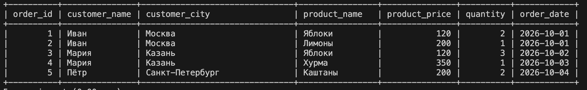
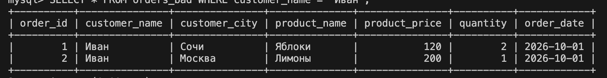
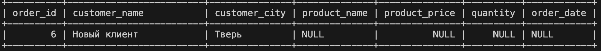
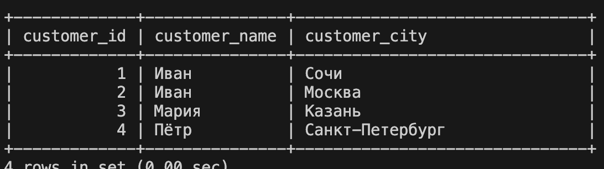
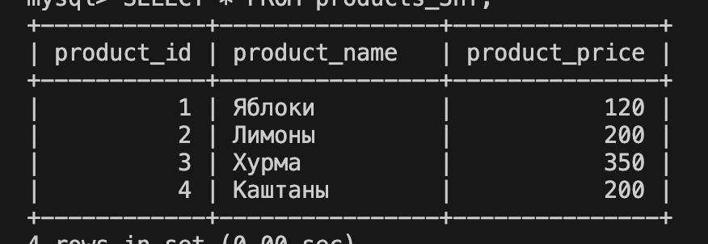
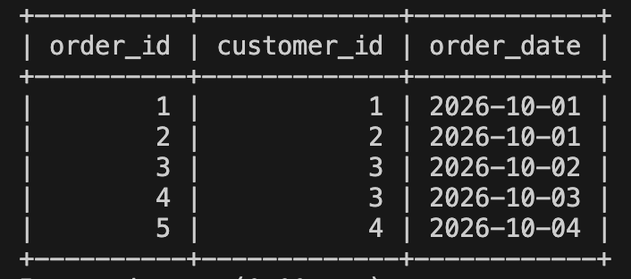
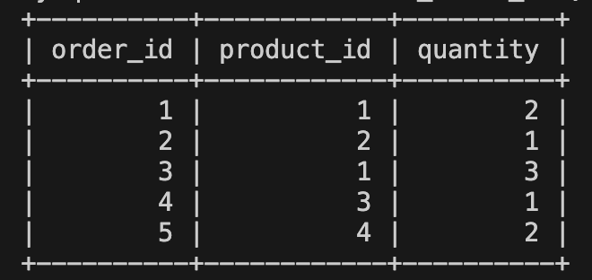
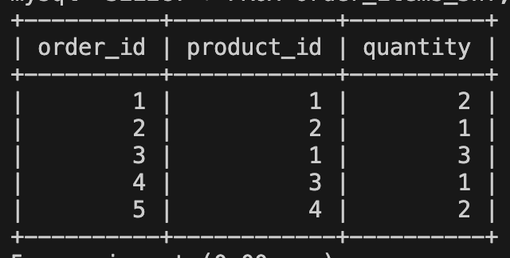
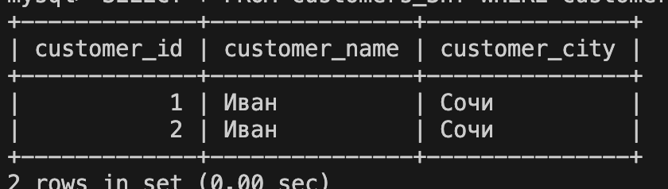
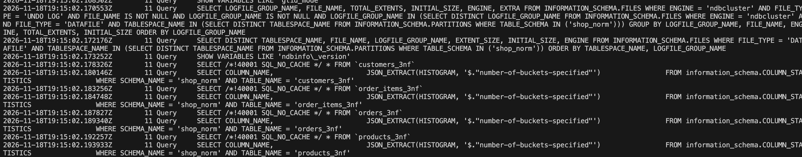

# 🗄️ Отчёт: Нормализация данных (3NF) в MySQL

> **Дисциплина:** Основы проектирования баз данных
> **Задание:** Нормализация базы данных до 3-й нормальной формы (3NF) с ведением лога.
> **Дата:** ноябрь 2026

---

## 📑 Содержание

1. [Цель работы](#-цель-работы)
2. [Среда выполнения](#-среда-выполнения)
3. [Ход выполнения](#-ход-выполнения)
   - [1. Создание «плохой» таблицы](#1-создание-плохой-таблицы)
   - [2. Демонстрация аномалий](#2-демонстрация-аномалий)
   - [3. Создание схемы 3NF](#3-создание-схемы-3nf)
   - [4. Проверка устранения аномалий](#4-проверка-устранения-аномалий)
   - [5. Дампы и лог](#5-дампы-и-лог)
4. [Вывод](#-вывод)
5. [Приложения](#-приложения)

---

## 🎯 Цель работы

Научиться приводить базу данных к третьей нормальной форме (3NF), устраняя аномалии обновления, удаления и вставки. Освоить перенос данных из плоской таблицы в нормализованную схему со связями и настройку логирования действий.

---

## 🛠 Среда выполнения

| Компонент | Версия / Значение |
|-----------|-------------------|
| ОС | macOS (Apple Silicon) |
| Терминал | zsh |
| Docker | Docker Desktop |
| Образ MySQL | `mysql:8.0` → **MySQL Community Server 8.0.46** |
| Кодировка | `utf8mb4` / `utf8mb4_unicode_ci` |
| Логирование | `general_log = 1`, `log_output = FILE` |

---

## 🚀 Ход выполнения

### 1. Создание «плохой» таблицы

Создана база данных `shop_norm` и таблица `orders_bad`, которая содержит дублирование данных (имя клиента и город повторяются в каждой строке заказа).

---

### 2. Демонстрация аномалий

**Аномалия обновления:** при изменении города Ивана только в одной строке (`UPDATE orders_bad SET customer_city = 'Сочи' WHERE order_id = 1;`), он начал жить в двух городах одновременно. Это связано с тем, что факт его проживания продублирован.

**Аномалия вставки:** невозможно добавить клиента без заказа. При попытке вставить «Нового клиента», все поля, относящиеся к заказу, заполняются `NULL`.

---

### 3. Создание схемы 3NF

Данные разделены на 4 таблицы, чтобы каждый факт хранился в одном месте:
- `customers_3nf` — клиенты (имя, город);
- `products_3nf` — товары (название, цена);
- `orders_3nf` — шапки заказов (кто, когда);
- `order_items_3nf` — позиции заказов (что, сколько).

**Таблица клиентов (до обновления):**

**Таблица товаров:**

**Таблица заказов:**

**Таблица позиций заказов:**

---

### 4. Проверка устранения аномалий

В нормализованной схеме аномалия обновления исчезла. Теперь, чтобы изменить город Ивана, достаточно сделать `UPDATE` в одной таблице `customers_3nf`. Все заказы автоматически «видят» новый город через `JOIN`.

---

### 5. Дампы и лог

Созданы дампы базы до (`dump_bad.sql`) и после (`norm_dump.sql`) нормализации, а также отфильтрован лог действий (`my_actions.log`).

Фрагмент лога действий пользователя, очищенный от служебного шума:

---

## ✅ Вывод

В ходе работы:

1. ✅ Продемонстрированы три вида аномалий «плоской» таблицы (обновление, вставка).
2. ✅ Создана нормализованная схема из 4 таблиц (3NF) с внешними ключами.
3. ✅ Данные перенесены с помощью `INSERT INTO ... SELECT DISTINCT`, проверено совпадение сумм и количества записей.
4. ✅ Подтверждено устранение аномалий: город меняется в одном месте, дублирования нет.
5. ✅ Сформированы дампы до/после и лог действий пользователя.

---

## 📎 Приложения

- 💾 [Дамп «плохой» БД](dump_bad.sql)
- 💾 [Дамп 3NF БД](norm_dump.sql)
- 📄 [Лог действий](my_actions.log)

---

  <i>© 2026</i>

